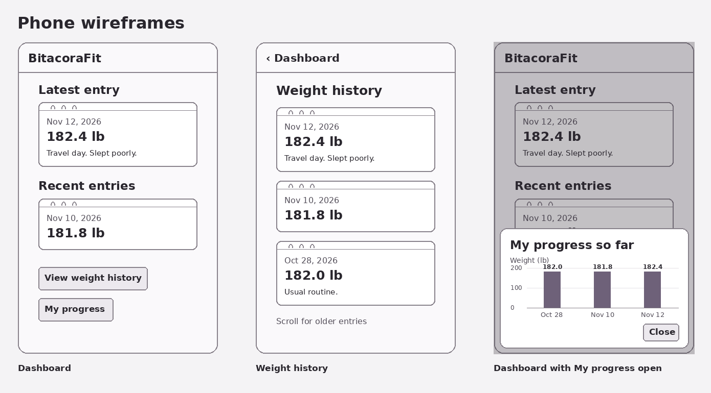
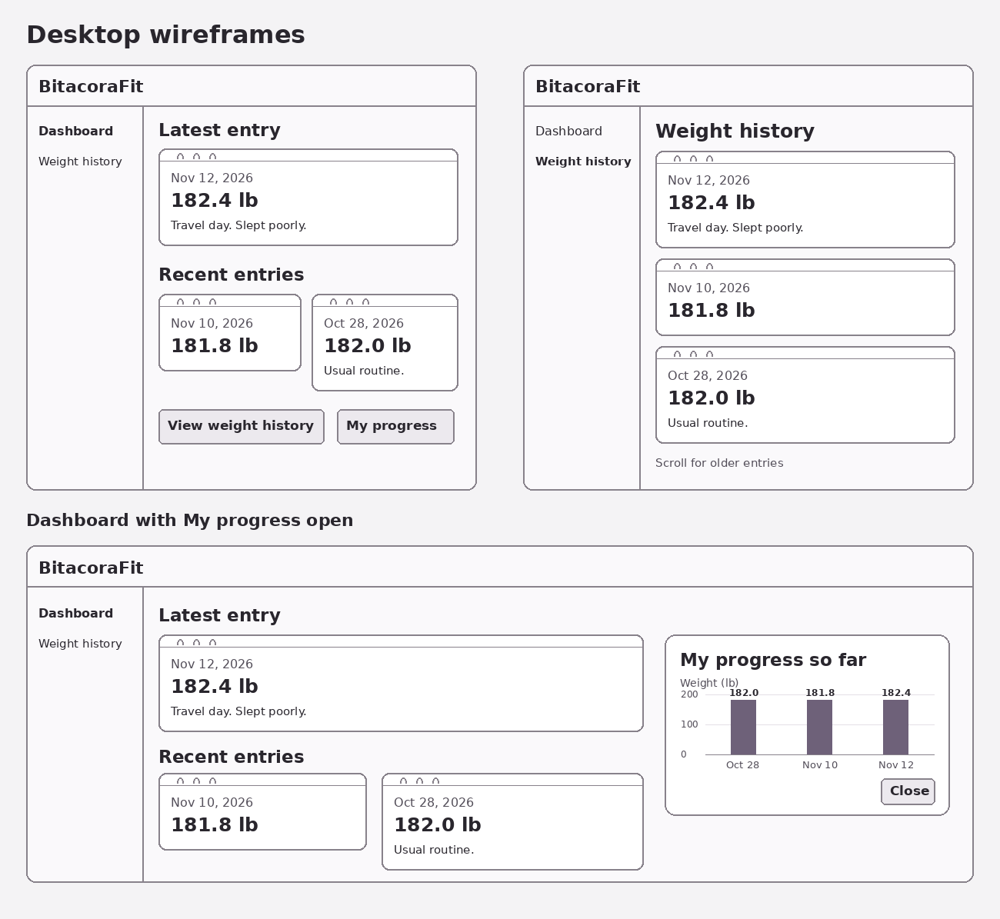

# First weight-history experience

Design draft for [issue #61](https://github.com/Theffy92/BitacoraFit/issues/61), based on [WH-01, AA-01, and AA-02](../../requirements/weight-history-stories.md).

## Storyboard

| Moment | What the user does | What the user sees |
| --- | --- | --- |
| A weigh-in is higher than expected | A returning user opens BitacoraFit to put the latest reading in context. | The dashboard shows their latest dated entry and a preview of recent entries. |
| The user wants a quick overview | They choose **My progress** on the dashboard. | **My progress so far** opens. They can close it and continue from the dashboard. |
| The user wants to look further back | They choose **View weight history**. | Their full history opens in newest-first order, including entries outside the dashboard preview. |
| The user checks their notes | They read dated entries and compare the latest note with an earlier one. | Each entry shows a weight and unit. Notes appear when present. |
| The user finishes reviewing | They go back to the dashboard or log out from the signed-in experience. | The dashboard is available again. After logout, revisiting history requires sign-in. |

The user leaves with their own records in view and can reflect on what they wrote around each weigh-in.

## Wireframes

The sample weights and notes are fictional. Each history card is a notebook page with a date, weight, unit, and optional note.

### Phone

The dashboard leads to a single-column history list. The history header returns to the dashboard. **My progress** opens a panel from the bottom of the dashboard.

### Desktop

The dashboard shows recent entries side by side. History uses a single reading column for chronological scanning. The sidebar links to both views. **My progress** opens a panel beside the dashboard entries.

The progress panel starts closed on both devices. The bar chart shows one weigh-in per bar, ordered from oldest to newest. Each bar is labeled with its recorded weight and date. The vertical axis starts at zero and uses pounds in this example. Decide which date ranges and how many entries to show when designing progress summaries.

## History states

| State | What appears on phone and desktop | Next action |
| --- | --- | --- |
| Loading | History header and “Loading weight history…” while the request is pending. | Wait or return to the dashboard. |
| Empty | “You don’t have any weight entries yet.” | Return to the dashboard. |
| Error | “We couldn’t load your weight history.” | Retry the history request or return to the dashboard. |
| Signed out or session expired | Sign-in screen with “Sign in to view your weight history.” Clear any displayed personal records. | Sign in and return to the requested history view. Invalid credentials show a sign-in error. |

## Acceptance walkthrough

This walkthrough checks the design against the stories. Account isolation, ordering, and recovery also need verification in the implemented client and API.

| Check | Expected result |
| --- | --- |
| Open history from each dashboard, then navigate back | **View weight history** opens the list on both devices. On phone use **Dashboard** in the header. On desktop use **Dashboard** in the sidebar. |
| Open and close **My progress** | The panel starts closed. **My progress** opens it and displays the weigh-ins in a bar chart ordered by date. **Close** returns the dashboard to its default layout. |
| Review a recent entry, an older entry, and one without notes | Each card displays date, weight, and unit. A note appears when provided. A missing note leaves that area blank. Older existing entries are reachable from history without re-entry. |
| Review two entries with the same recorded date | Both appear. The entry created more recently appears first. |
| Open history with an account that has no entries | The empty message appears after loading completes. |
| Simulate a slow request, then a failed request | Loading and error messages are distinct. Retry makes a fresh request. |
| Open history signed out, then sign in as a different user | Sign-in gates access. The history request uses the active account and shows only that account’s entries. |
| Log out from the signed-in experience, then reopen history | The client clears the displayed records and prompts for sign-in again. |

## Draft decisions and open questions

- Use **Latest entry** as the dashboard label because the most recent weigh-in may have been recorded on an earlier date. The notebook treatment is limited to the entry cards in this draft.
- Show `lb` in the sketches because the current Django model stores pounds. Decide whether to offer a unit preference in the first client.
- Show short notes inline and leave absent notes blank. Decide whether long notes expand in place or open a dedicated entry view.
- Keep older entries accessible in history. Decide how many entries to show initially and whether to fetch more as the user scrolls or through **Load more**.
- Revisit goal display and progress calculations when designing summaries and trends.
